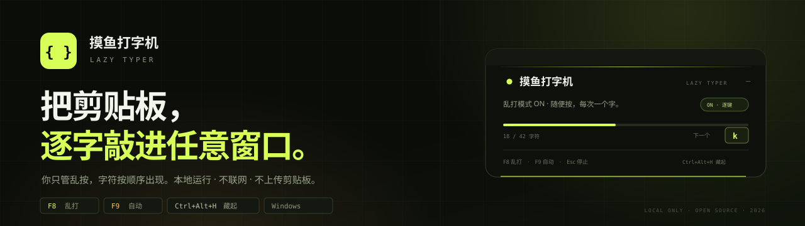
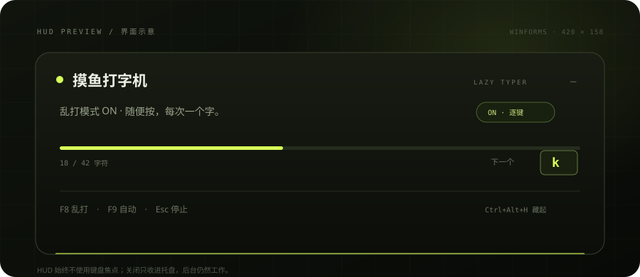

<div align="center">
  
</div>

# LazyTyper · 摸鱼打字机

> 把剪贴板里的文字，逐字符送进当前窗口。  
> 你只管乱按，字会自己出现。

[](#系统要求)
[](#从源码构建)
[](LICENSE)
[](#隐私与安全)

**[下载 LazyTyper.exe](dist/LazyTyper.exe)** · [快速开始](#30-秒上手) · [后台模式](#后台与托盘模式) · [如何上传到 GitHub](UPLOAD_GUIDE.md) · [English](#english)

---

## 这是什么

**LazyTyper（摸鱼打字机）** 是一个完全本地运行的 Windows 小工具。

它读取你的剪贴板，然后通过全局键盘钩子把内容**逐个字符**输出到当前焦点窗口：

- **F8 乱打模式**：之后你随便按什么普通键，工具都会忽略原来的字符，改为输出剪贴板的下一个字符。
- **F9 自动模式**：无需按键，工具以约 22ms 一个字符的速度自动输出。
- **Esc**：停止并把键盘交还给你。

它不依赖浏览器或任何特定软件，记事本、Word、VS Code、浏览器输入框、聊天窗口都能用。

> 这是一个开源玩笑 / 本地自动化小工具。请不要用它糊弄真正计分的考试或需要本人操作的工作。

<p align="center">
  
</p>

<p align="center"><sub>HUD 界面示意。实际程序为 WinForms 原生绘制，可拖动、可收进托盘。</sub></p>

## 功能

- **任意键映射**：F8 开启后，字母、数字、空格、标点、回车、Tab 都可以当前进键；按住不放也会连续输出。
- **两种模式**：F8 手动逐键，F9 自动逐字，随时切换。
- **中文与 Unicode**：使用 `SendInput` 的 Unicode 注入，不依赖输入法和键盘布局。
- **换行 / Tab**：剪贴板中的换行会输出为 Enter，Tab 会输出为 Tab。
- **失焦保护**：目标窗口失去前台时自动停止，不把内容打进别的窗口。
- **完成保护**：输出完后进入 DONE，继续吃掉普通按键，避免多按的字污染结果；按 Esc 交还键盘。
- **后台运行**：HUD 可以收进系统托盘；`--hidden` 启动时只留托盘图标，F8/F9 仍然可用。
- **托盘状态**：托盘 tooltip 与菜单显示当前模式、进度和快捷键。
- **纯本地**：没有网络请求，不读取服务器；剪贴板只在开始模式时读取一次。
- **零依赖**：源码 + 一个 build 脚本，使用 Windows 自带的 .NET Framework 编译器。

## 下载

| 文件 | 说明 |
| --- | --- |
| [dist/LazyTyper.exe](dist/LazyTyper.exe) | 可直接运行的 Windows 程序（约 27 KB） |
| [源码](src/LazyTyper.cs) | 单文件 WinForms + Win32 API 实现 |
| [源码构建](#从源码构建) | 不想运行未知 exe？自己编译 |

> `LazyTyper.exe` 未签名。Windows SmartScreen 或杀毒软件可能提示，这是因为它会使用全局键盘钩子。源码完全公开，可自行审阅和构建。

## 30 秒上手

1. 复制你想输出的文字。
2. 双击 `LazyTyper.exe`，右下角出现 HUD。
3. 点一下目标输入框，让它保持前台。
4. 按 **F8**，然后随便按几个键；或按 **F9** 让它自己打。
5. 按 **Esc** 停止。
6. 如果输出已结束，工具会停在 DONE；再按一次 **Esc** 交还键盘。

右上角的横线、`Ctrl+Alt+H` 或托盘左键单击都可以把 HUD 藏进托盘。

## 两种模式

| 模式 | 快捷键 | 行为 | 适合 |
| --- | --- | --- | --- |
| 乱打模式 | `F8` | 每按一个普通键，输出剪贴板的下一个字符 | 假装在敲字、随便乱按 |
| 自动模式 | `F9` | 每 22ms 自动输出一个字符 | 挂机、快速灌模板 |
| 停止 | `Esc` | 结束当前模式并交还键盘 | 任何时候 |

快捷键被占用时：

- F8 会被替换为 `Ctrl+Alt+L`
- F9 会被替换为 `Ctrl+Alt+A`
- HUD 底部会显示实际可用的快捷键；托盘菜单始终可以操作。

## 后台与托盘模式

- 点击 HUD 右上角的小横线：**收进托盘**，当前模式继续运行。
- `Ctrl+Alt+H`：隐藏 / 召回 HUD。
- 左键单击托盘荧光 `{}` 图标：显示 / 隐藏 HUD。
- 托盘菜单：开始/停止乱打、开始/停止自动、停止、隐藏/显示 HUD、重读剪贴板、退出。
- **纯后台启动**：

  ```powershell
  .\LazyTyper.exe --hidden
  ```

  启动后只有托盘图标，不弹出 HUD；F8/F9 仍然有效。适合放到开机启动或桌面快捷方式里。

- 后台时鼠标悬停托盘图标可以看到模式和进度。真正退出请从托盘菜单选择“退出摸鱼打字机”。

## 快捷键

| 操作 | 快捷键 |
| --- | --- |
| 开始 / 停止乱打 | `F8`（被占用时 `Ctrl+Alt+L`） |
| 开始 / 停止自动 | `F9`（被占用时 `Ctrl+Alt+A`） |
| 隐藏 / 显示 HUD | `Ctrl+Alt+H` |
| 停止当前模式 | `Esc` |
| 退出程序 | 托盘菜单 → 退出 |

## 工作原理

LazyTyper 使用 Windows 的 `WH_KEYBOARD_LL` 低级键盘钩子：

1. 开始模式时读取一次剪贴板，并按 UTF-16 位置保存文本。
2. 当模式激活时，拦截普通按键并吞掉原始输入。
3. 对每个被拦截的按键，用 `SendInput` 的 `KEYEVENTF_UNICODE` 输出剪贴板的下一个字符。
4. 注入的输入带有 `dwExtraInfo` 魔数标记，键盘钩子会跳过它们，避免自我循环。
5. 换行和 Tab 分别通过虚拟键 `VK_RETURN` / `VK_TAB` 发送。
6. 目标窗口失去前台时自动停止；内容输出完后进入 DONE 继续拦截，直到 Esc。
7. HUD 是 WinForms 绘制的无激活窗口，不会抢走目标程序的键盘焦点。

项目只使用 Windows 自带的 .NET Framework 和 Win32 API，不需要 NuGet 包或运行时安装。

## 系统要求

- Windows 10 / 11（x64 / x86）
- .NET Framework 4.x（Windows 10/11 自带）
- 不需要管理员权限；除非你要输入到以管理员权限运行的程序

## 限制与注意事项

- **只支持 Windows**。Linux/macOS 没有等价的 Win32 键盘钩子实现。
- 未签名程序：SmartScreen 可能提示。确认信任后可自行构建。
- 部分杀毒软件会对全局键盘钩子 + 自动输入敏感，可能误报或拦截。
- 目标程序以管理员权限运行时，需要以管理员权限运行本工具（Windows UIPI 限制）。
- 带防注入保护的程序、部分游戏、密码/安全输入框可能拒绝这些字符。
- Emoji 等代理对字符在部分目标应用中可能无法完整显示；常用中文、ASCII、代码符号正常。
- 完成后的 DONE 清空保护依赖你按 Esc 结束；不要在没有结束的情况下直接退出目标程序。
- F8/F9 是全局热键，工具运行时会暂时占用它们。
- 界面目前只有中文；快捷键和使用方式见上方。
- 请只在允许自动输入的环境使用。

## 隐私与安全

- 无网络请求、无遥测、无自动更新。
- 启动某次输出时只读取一次剪贴板，不保存历史剪贴板。
- 目标窗口、输入内容、剪贴板都只在本机内存中处理。
- 错误日志只会写到程序目录下的 `lazy-typer.log`（发生异常时），不包含剪贴板内容。
- 源码在 `src/LazyTyper.cs`，可以直接审阅。

## 从源码构建

要求 Windows 和 .NET Framework（Windows 10/11 自带，无需安装 Visual Studio）。

```powershell
git clone https://github.com/<your-name>/Lazy-autoTyper.git
cd Lazy-autoTyper
powershell -ExecutionPolicy Bypass -File .\scripts\build.ps1
```

输出：

```text
dist/LazyTyper.exe
```

构建脚本会自动寻找 `C:\Windows\Microsoft.NET\Framework64\v4.0.30319\csc.exe`（或 32 位版本）。

推送到 GitHub 后，Actions 会在 push 到 `main` 或提交 PR 时自动构建，并把 exe 作为 Workflow artifact 上传。

## 项目结构

```text
Lazy-autoTyper/
├─ src/
│  ├─ LazyTyper.cs        # 全部程序逻辑：WinForms HUD + 键盘钩子 + SendInput
│  └─ AssemblyInfo.cs     # 版本与产品信息
├─ scripts/
│  └─ build.ps1           # 使用 .NET Framework csc 编译到 dist/
├─ dist/
│  └─ LazyTyper.exe        # 可直接下载运行
├─ assets/
│  ├─ banner.svg          # README 横幅
│  └─ hud-preview.svg     # HUD 界面示意
├─ .github/workflows/
│  └─ build.yml            # GitHub Actions 自动构建
├─ README.md
├─ UPLOAD_GUIDE.md         # 第一次上传 GitHub 的保姆级教程
├─ CHANGELOG.md
├─ CONTRIBUTING.md
├─ LICENSE
├─ .gitignore
├─ .gitattributes
└─ .editorconfig
```

## 上传到 GitHub

如果这是你第一次发布仓库，看 **[UPLOAD_GUIDE.md](UPLOAD_GUIDE.md)**。里面手把手写了：

- 网页上传（不安装任何软件）
- GitHub Desktop 和 Git 命令行的替代方式
- 创建第一个 Release、填写仓库简介和 Topics
- 以后更新项目的流程

## 参与贡献

欢迎 Issue 和 PR。请先看 [CONTRIBUTING.md](CONTRIBUTING.md)。

## English

**LazyTyper** is a tiny Windows utility that types clipboard text into any focused app, one character at a time.

- Copy text to the clipboard.
- Run `dist/LazyTyper.exe`.
- Focus the target input, press **F8** to make every keypress emit the next character, or **F9** to auto-type. Press **Esc** to stop.
- Click the dash in the HUD or press **Ctrl+Alt+H** to hide it in the system tray. Run `LazyTyper.exe --hidden` for tray-only startup.
- Everything is local. No network, no telemetry. Source and build script included.

## License

[MIT](LICENSE) © 2026 Lazy-autoTyper contributors

---

如果它让你笑了一下，点个 Star 吧。⭐
